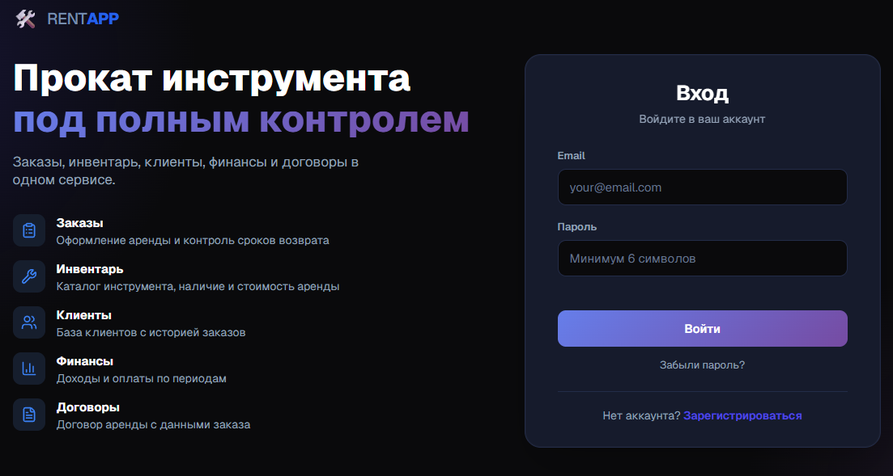
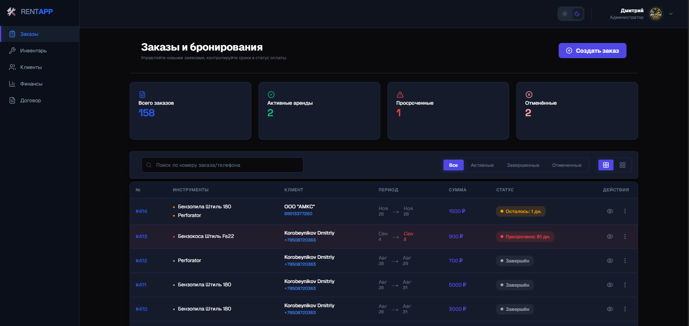
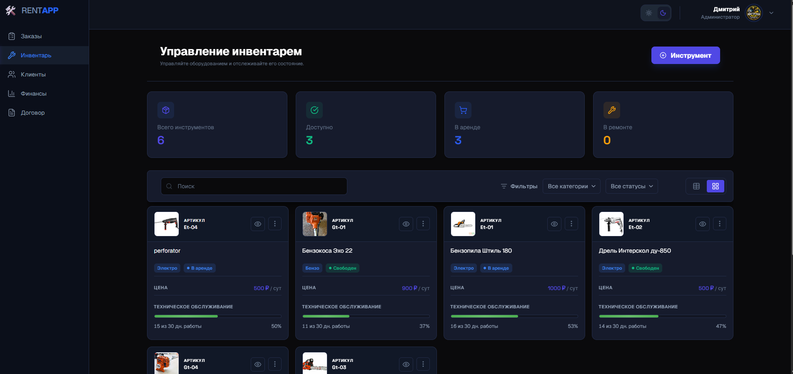
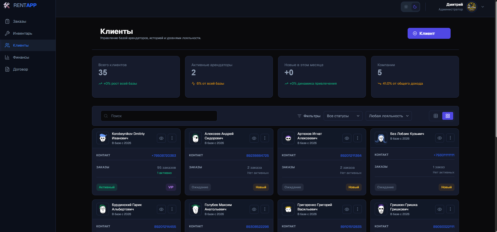
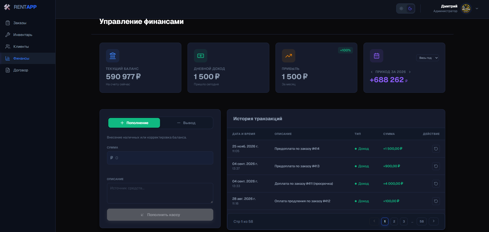

# RentApp — Tool Rental Management System

A full-stack web application for managing a tool rental business. The application provides a centralized workspace for managing clients, inventory, rental orders, bookings, payments, and financial records.

## Overview

RentApp was developed to manage day-to-day operations of a real tool rental business.

The application combines client management, inventory tracking, rental operations, and financial accounting in a single system.

## Screenshots

## Features

- **Client management** — manage client profiles and customer information.
- **Inventory management** — maintain equipment catalog and inventory records.
- **Rental orders** — create and manage rental orders.
- **Bookings** — handle equipment reservations.
- **Financial management** — track payments, additional charges, discounts, and outstanding balances.
- **Documents** — manage rental-related documentation.
- **Image uploads** — upload and display equipment images.

## Tech Stack

### Frontend

- Next.js
- React
- TypeScript

### Backend

- Next.js server-side functionality
- NextAuth.js
- Prisma ORM

### Database

- PostgreSQL

### Infrastructure

- Docker (local development database)
- Linux VPS
- PM2
- Nginx
- SSH / SCP

## Technical Implementation

- Designed and maintained a relational database schema using Prisma.
- Implemented server-side logic and database operations.
- Migrated the database from Supabase to self-hosted PostgreSQL.
- Configured a local PostgreSQL environment using Docker.
- Implemented file uploads and inventory image handling.
- Configured production deployment using Next.js standalone output.
- Created custom PowerShell and Bash deployment scripts.
- Implemented atomic deployment with health checks and automatic rollback.
- Configured production process management using PM2.

## Deployment

The application is deployed to a Linux VPS.

Production deployment is automated using custom PowerShell and Bash scripts. The process includes building the application, preparing deployment files, transferring the build via SSH, restarting the application, checking availability, and rolling back if deployment fails.

Detailed deployment instructions are available in [DEPLOY.md](./DEPLOY.md).

## Project

Developed independently as a full-stack application for a real tool rental business.
